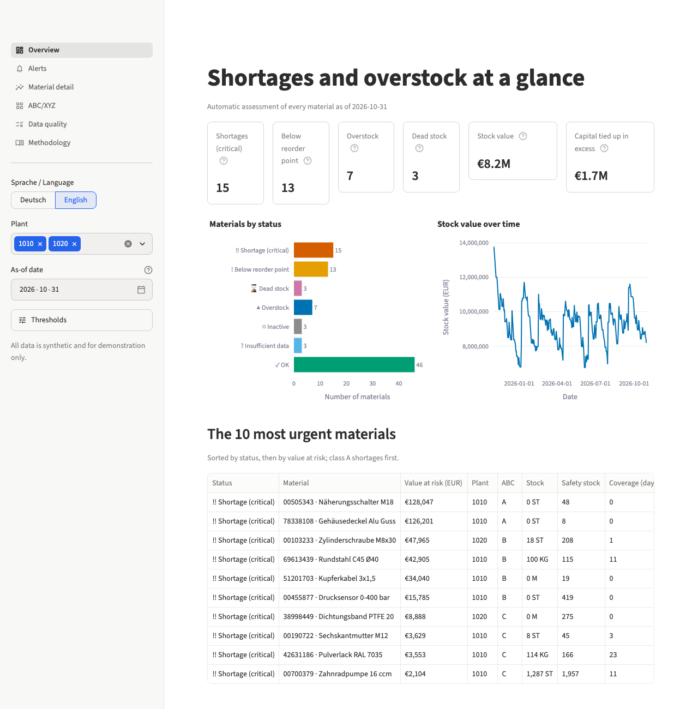
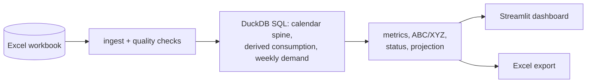

# Inventory Health Monitor

Detects shortages and overstock automatically from daily stock levels and goods receipts,
and shows them in a bilingual (German/English) Streamlit dashboard.

[](https://github.com/Umutakkopru/inventory-health-monitor/actions/workflows/ci.yml)

[](LICENSE)

**Live demo:** <https://inventory-health-monitor.streamlit.app/>
(Streamlit Community Cloud; the first load after a quiet period can take a moment while the app wakes up.)



## The problem

A warehouse exports an Excel file with the daily stock per material and the goods
receipts. From that file alone, a material planner wants to know which materials are about
to run short, which ones tie up too much capital, and which data cannot be trusted. This
project answers that question end to end: it reads and checks the export, derives
consumption, calculates the usual inventory key figures, and flags each material with one
status. All data in this repository is synthetic.

## Approach

1. **Ingest and validate.** Read the three sheets with German SAP-style headers, keep
   material numbers as text, and run eleven data-quality checks (missing days, negative
   stock, duplicates, unknown materials, lost leading zeros and more).
2. **Derive consumption.** In DuckDB SQL, build a complete calendar per material and
   derive daily consumption as `stock yesterday + receipts − stock today`, spreading gaps
   evenly over the missing days.
3. **Calculate key figures.** Average demand, weekly variability, safety stock, reorder
   point, days of coverage and an overstock limit per material, as of any chosen date.
4. **Classify.** ABC by consumption value and XYZ by demand regularity, per plant.
5. **Assign a status.** Seven statuses, checked in a fixed order, from critical shortage to
   OK, plus anomaly flags and a projection of the stock if no further receipt arrives.

## Features

- Overview page with headline figures, status distribution, stock value over time and the
  ten most urgent materials.
- Filterable, sortable alert table with Excel export of exactly the filtered rows.
- Material detail chart: stock, safety stock, reorder point, maximum, receipts, derived
  consumption, missing days and the projection with its band.
- ABC/XYZ matrix, Pareto chart and a list of master data that deviates strongly from the
  calculated values.
- Data-quality page with every finding, what was done about it, and a score per material.
- Adjustable thresholds and as-of date; results never use data after the as-of date.
- German and English UI, including number and date formats; light and dark theme.

## Method

| Figure | Formula | Why |
|---|---|---|
| Derived consumption | `stock(p) + receipts in (p, d] − stock(d)`, spread over the days from `p` to `d` | The export has no consumption postings, so consumption is reconstructed from stock and receipts. |
| Average daily demand | Mean derived consumption over the last 90 days | Basis for coverage and the reorder point. |
| Weekly variability σ | Sample standard deviation of weekly demand over the last 26 complete weeks | Weekly rather than daily, because weekends without demand would inflate a daily spread. |
| Safety stock | `z × σ × √(lead time / 7)`, with `z` from the service level of the ABC class (98 / 95 / 90 %) | Buffer against demand variation while a replenishment is on its way. |
| Reorder point | `average daily demand × lead time + safety stock` | Stock level at which a new order should be placed. |
| Days of coverage | `stock / average daily demand` | How long the stock lasts at the current rate. |
| Overstock limit | `average daily demand × target coverage` (60 / 90 / 180 days for A / B / C) | Above this level, stock ties up capital without need. |
| ABC class | Cumulative share of the 12-month consumption value: A up to 80 %, B up to 95 % | Focuses attention on the materials that carry the value. |
| XYZ class | Coefficient of variation of weekly demand: X < 0.5, Y ≤ 1.0, Z above | Separates predictable from erratic demand. |

Minimum and maximum stock from the material master take precedence over the calculated
values; the dashboard shows both and lists large deviations.

Statuses are checked in this order, the first match wins: insufficient data, inactive,
shortage (critical), below reorder point, dead stock, overstock, OK. There is deliberately
no rule "coverage below lead time is critical": under a reorder-point policy every healthy
material spends part of each cycle below one lead time of stock.

The [Methodology page](app/views/methodology.py) of the dashboard explains every rule in
plain language, with the threshold values currently set.

## Architecture

All data processing lives in `inventory_monitor/`, which never imports Streamlit; the
dashboard in `app/` contains no formulas. The full diagram and module table are in
[docs/architecture.md](docs/architecture.md).



| Module | Responsibility |
|---|---|
| `inventory_monitor/ingest.py` | Read the workbook, map German headers, raise on structural errors |
| `inventory_monitor/quality.py` | Data-quality checks DQ01–DQ11 and the quality score |
| `inventory_monitor/transform.py`, `sql/` | Calendar spine, derived consumption, weekly demand |
| `inventory_monitor/metrics.py` | Key figures per material as of a date |
| `inventory_monitor/classify.py` | ABC and XYZ |
| `inventory_monitor/detect.py` | Status, priority, anomaly flags |
| `inventory_monitor/forecast.py` | Projection without further receipts |
| `inventory_monitor/pipeline.py` | `prepare` (once per file) and `analyse` (per date and thresholds) |
| `inventory_monitor/report.py` | Excel export |
| `app/`, `streamlit_app.py` | Dashboard pages, translations, state and caching |

## Data

The sample workbook [`data/sample_inventory.xlsx`](data/sample_inventory.xlsx) is
generated by `python -m inventory_monitor.generate_data` with a fixed seed: 60 materials
in two plants (90 material-plants), 365 days from 2025-11-01 to 2026-10-31. Each
material-plant is simulated day by day under a reorder-point policy, so stock, receipts
and consumption are consistent with each other.

Eight scenarios are embedded, three material-plants each, so that the expected result is
known in advance and checked by the tests:

| Scenario | What happens | Expected status |
|---|---|---|
| `delayed_delivery` | A late order never arrives | Shortage (critical) |
| `demand_spike` | Demand triples in the last weeks | Shortage or below reorder point |
| `stockout` | Ordering stops, stock runs out, demand continues | Shortage (critical) |
| `over_ordering` | One very large receipt | Overstock |
| `demand_drop` | Demand falls to a fifth, orders continue | Overstock |
| `dead_stock` | Consumption stops for good months before the end | Dead stock |
| `new_material` | First snapshot only weeks before the end | Insufficient data |
| `phased_out` | Stock runs to zero mid-year, no demand afterwards | Inactive |

After the simulation, data defects are injected and logged in
[`data/scenario_manifest.json`](data/scenario_manifest.json): about 1 % missing days
(including gaps of two to four days and partial storage-location snapshots), negative
stock, exact and conflicting duplicates, receipts for unknown materials, material numbers
without leading zeros and receipts that were never booked. The tests check that the
quality layer finds exactly these rows.

## Quick start

Requires Python 3.12.

```bash
git clone https://github.com/Umutakkopru/inventory-health-monitor.git
cd inventory-health-monitor
python3.12 -m venv .venv
source .venv/bin/activate
pip install -r requirements-dev.txt
```

Run the dashboard (opens on <http://localhost:8501>):

```bash
streamlit run streamlit_app.py
```

Run the checks:

```bash
ruff check .
ruff format --check .
pytest --cov=inventory_monitor
```

Regenerate the sample data (the result is identical to the committed files):

```bash
python -m inventory_monitor.generate_data
```

## Assumptions and limitations

- A stock snapshot is the end-of-day stock; receipts posted on a day are included in that
  day's stock.
- The task names only stock levels and goods receipts. The material master (price, lead
  time, minimum and maximum stock) is an additional assumption; minimum and maximum stock
  may be empty.
- If one storage location has no snapshot on a day, the whole day counts as missing, since
  a partial sum would look like a drop in stock.
- Derived consumption is a net outflow and also contains scrap, transfers and inventory
  corrections.
- Demand during a stock-out is hidden: at zero stock nothing is consumed, so demand is
  underestimated.
- There are no open purchase orders in the data. "Below reorder point" therefore means
  "check that an order is open", not "order now".
- The projection assumes no further receipts; it is not a demand forecast, and seasonality
  is not modelled.
- All data is synthetic.

## Possible next steps

- Net the reorder-point warning against open purchase orders from the ERP.
- File upload in the dashboard; `load_workbook` already accepts a file-like object.
- A Power BI report on top of the same SQL model.
- E-mail alerts for new critical shortages.

## Licence

[MIT](LICENSE)
