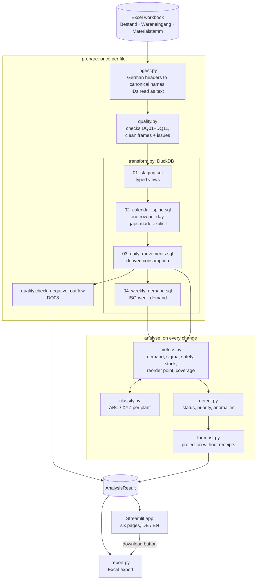

# Architecture

The project has two layers. `inventory_monitor/` holds all data processing and business
rules and never imports Streamlit. `app/` and `streamlit_app.py` hold the dashboard and
contain no formulas; they call only `pipeline`, `models`, `config` and `report`. A test
(`tests/test_architecture.py`) enforces both rules.

## Data flow

`prepare` is `pipeline.prepare(source)`; `analyse` is
`pipeline.analyse(prepared, as_of, thresholds)`. `metrics.py` calls `classify.py` in the
middle of its work: the ABC class needs the annual consumption value, and the safety stock
needs the ABC class.

## Modules

| Module | Responsibility |
|---|---|
| `config.py` | Paths, workbook layout, column mapping, fixed constants and the `Thresholds` dataclass |
| `models.py` | `Status`, the urgency order, `WorkbookFormatError` and the frozen result containers |
| `generate_data.py` | Deterministic synthetic workbook and scenario manifest |
| `ingest.py` | Reads the workbook; the only module that raises for bad input |
| `quality.py` | Data-quality checks, issues table and quality score |
| `transform.py` + `sql/` | Calendar spine, derived consumption and weekly demand in DuckDB |
| `metrics.py` | Per-material key figures as of a date |
| `classify.py` | ABC and XYZ classification |
| `detect.py` | Status assignment, priority score, anomaly flags, urgency order |
| `forecast.py` | Demand rate, projection and crossing dates |
| `pipeline.py` | `prepare` and `analyse`, plus the summaries the dashboard shows |
| `report.py` | Excel export and the shared status, column and threshold labels |
| `app/state.py` | Session-state keys, defaults and the cached pipeline calls |
| `app/i18n.py` | German and English strings, number and date formatting |
| `app/theme.py` | Status colours, icons and symbols |
| `app/components.py` | KPI cards, badges, chart layout, empty states |
| `app/views/` | One module per page, each with a `render()` function |

## Caching

`pipeline.prepare` depends only on the file and is cached once for all sessions.
`pipeline.analyse` is cached per as-of date and threshold combination; `Thresholds` is a
frozen dataclass of scalars so that it can serve as a cache key. Cached results are never
modified: every function returns new DataFrames. The DuckDB connection is opened and
closed inside `transform.build_tables` and never cached.
